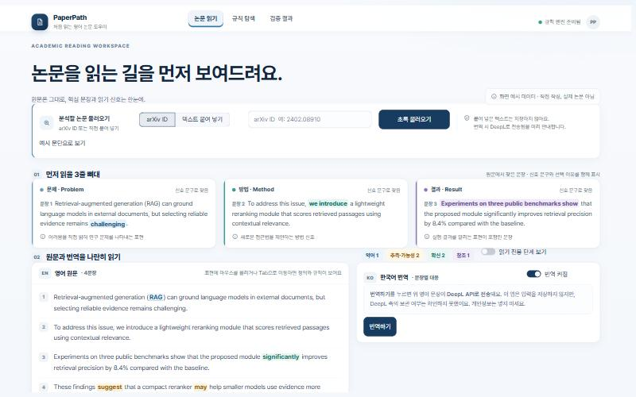

# PaperPath — 처음 읽는 영어 논문 도우미

「영어데이터 처리를 위한 프로그래밍」(Regular Expression with Python) 기말 프로젝트입니다.

영어 논문 초록이나 단락을 넣으면 **정규표현식이** 먼저 읽을 문장 3개(문제·방법·결과)를 원문에서 고르고, 약어·추측·확신·참조 표현을 근거와 함께 표시합니다. 필요하면 한국어 번역을 문장 단위로 옆에 켭니다. AI가 대신 요약하지 않습니다. **읽는 길은 정규식이, 판단은 학생이.**

> **공개 사이트: https://paperpath-hufs.streamlit.app/** (Streamlit Community Cloud, 2026-11-04 배포)
>
> 현재 상태: **Phase 3 (구현 중)** · 마감 2026-11-30 · 진행 기록은 [docs/PROGRESS.md](docs/PROGRESS.md), 계획은 [docs/PLAN.md](docs/PLAN.md)를 보세요.



## 실행 방법

Windows(Git Bash) 기준입니다. Python 3.14에서 확인했습니다.

```bash
py -m venv .venv
.venv/Scripts/python.exe -m pip install -r requirements.txt
.venv/Scripts/python.exe -m streamlit run app.py
```

브라우저에서 `http://localhost:8501`이 열립니다.

### 번역(선택)

번역 엔진은 두 가지입니다. `ANTHROPIC_API_KEY`가 있으면 **Claude Haiku 5.5**(`claude-haiku-5-5`, AI 번역, 유료)를 쓰고, 없으면 **DeepL API Free**를 씁니다. 두 엔진 모두 같은 태그 방식(보호 `<x>`, 형광펜 `<m>`, 밑줄 `<u>`, 문장 `<s>`)으로 보내고 정규식으로 복원합니다. 키가 없어도 정규식 기능은 모두 동작하고, 예시 문단은 저장된 번역으로 볼 수 있습니다.

1. `cp .env.example .env`
2. `.env`에 `ANTHROPIC_API_KEY=<본인 키>` 또는 `DEEPL_API_KEY=<본인 키>`를 적습니다. **`.env`는 커밋되지 않습니다.**
3. 번역은 화면의 **번역하기** 버튼을 눌렀을 때만 호출됩니다. 입력한 영어 문장이 고른 번역 서비스로 전송됩니다.

논문 PDF의 긴 절은 엔진의 한 번 한도(Claude 4,000자, DeepL 3,000자) 이하 묶음으로 나눠 차례로 번역하고 이어 붙입니다.

Claude API 키는 [console.anthropic.com](https://console.anthropic.com)에서 만들며 무료 등급이 없습니다. 콘솔의 월 사용 한도(spend limit)를 낮게 걸어 두는 것을 권장합니다. Haiku 5.5 요금은 입력 100만 토큰당 $0.10, 출력 $0.50입니다.

### 공개 사이트로 배포 (Streamlit Community Cloud)

1. [share.streamlit.io](https://share.streamlit.io)에 GitHub 계정으로 로그인합니다.
2. **Create app** → **Yup, I have an app** → 저장소 `uisang2004-maker/eng-data-regex-project`, 브랜치 `main`, 파일 `app.py`를 고릅니다.
3. **Advanced settings**에서 Python 3.12를 고르고, **Secrets** 칸에 `ANTHROPIC_API_KEY = "본인 키"`(또는 `DEEPL_API_KEY = "본인 키"`)를 적습니다. 키는 이 칸에만 적고 저장소에는 넣지 않습니다.
4. **Deploy**를 누릅니다. 비공개 저장소에서 만든 앱은 처음에 비공개라서, 앱의 **Share → Make this app public**으로 공개합니다.

공개 사이트의 번역은 비용과 무료 한도를 지키기 위해 제한됩니다([src/usage.py](src/usage.py)).

| | Claude Haiku 5.5 | DeepL Free |
|---|---|---|
| 한 번(묶음) | 4,000자 | 3,000자 |
| 한 화면(세션) | 60회 | 10회 |
| 사이트 전체 하루 | 300,000자 | 30,000자 |

하루 사용량은 서버 파일로 세기 때문에, 서버가 재시작되면 다시 0부터 셀 수 있습니다. 실제 기준은 번역 서비스 계정(Anthropic 콘솔·DeepL)의 사용량입니다.

### 테스트

```bash
.venv/Scripts/python.exe -I -m pytest -q
```

### 데이터 재현

```bash
.venv/Scripts/python.exe -m src.collect
```

arXiv cs.CL 초록을 연도별(2012·2015·2018·2021·2024·2025) 50편씩 받아 `data/processed/sample_abstracts.jsonl`에 저장합니다. 요청 사이에 3초를 두고, 저자 필드는 저장하지 않습니다.

## 화면

| 탭 | 내용 |
|---|---|
| 논문 읽기 | 처음에는 입력 칸과 사용 순서만 보임. **논문 PDF를 끌어다 놓으면 바로 분석**(arXiv ID·텍스트도 가능) → (PDF면 **초록 · 본문(절별) · 결론** 쪽 고르기) → 3줄 뼈대 → 원문 하이라이트·번역(**읽기 모드: 한영 나란히 · 문장마다 한영 · 영어 원문만 · 한국어만**) → 흐름도·어려운 단어표 |
| 규칙 탐색 | 처리 단계, 준비된 규칙 켜고 끄기(자유 정규식 입력은 없음), 규칙별 패턴·예시·놓치는 경우 |
| 검증 결과 | 측정한 값과 목표·예정을 구분해 표시 |

## 핵심 정규식

모든 규칙은 [src/patterns.py](src/patterns.py)에 있고, 패턴마다 잡는 것·예시·일부러 놓치는 경우를 적었습니다.

| 기능 | 정규식이 하는 일 |
|---|---|
| 입력 정리 | 줄바꿈·연속 공백·줄 끝 하이픈·쪽번호 줄·반복 머리말 정리 |
| 문장 분리 | `e.g.`·`et al.`·`Fig.` 같은 약어, 수식·인용·URL 안의 마침표에서 자르지 않음 |
| 약어 | 괄호 안 약어 후보를 정규식으로 찾고, 앞 단어 첫 글자와 Python 함수로 맞춤 |
| 3줄 뼈대 | 문제·방법·결과 신호 문구. 없으면 위치로 대체하고 "추정"이라고 표시 |
| 추측·확신·참조 | `may`·`suggest` 등(가능·허용 뜻은 제외), `significantly` 등, `[4]`·`(Smith et al., 2021)`·`Table 2` |
| 번역 보호 | 약어·인용·참조를 `<x>`로 감싸 번역에서 보호하고, 문장마다 `<s>` 태그로 영한 짝을 복원. 수치는 실측 결과 보호하지 않음([docs/MASKING_BENCHMARK.md](docs/MASKING_BENCHMARK.md)) |
| 번역문 형광펜 | 영어 형광펜을 `<m>` 태그로 감싸 보내고, 번역기가 옮긴 태그를 정규식으로 찾아 한국어 문장에도 같은 색을 칠함 |
| 핵심 내용 밑줄 | 형광펜이 신호라면 밑줄은 내용. 3줄 뼈대 문장에서 신호 문구가 가리키는 구간(12단어 이내)에 밑줄을 긋고, 번역문과 카드 아래 번역에도 옮김 |
| 용어 설명·수치 | `refers to`·`, which is …`·`such as`·`(i.e., …)`·동격(`X, a …,`) 뒤의 설명 구간에 점선 밑줄, `8.4%`·`accuracy of 74%` 같은 수치 근거에 형광펜 |
| 반복 용어 | 이 글에서 3번 이상 나오는 용어(기능어·일반어 제외, 두 단어 용어 우선)에 굵은 글씨와 얇은 밑줄 |
| 논문 PDF 절 나누기 | `1 Introduction`·`3.2 Pre-training BERT`·`II. RELATED WORK`·`ABSTRACT` 같은 절 제목 줄을 찾음. 번호가 1, 2, 3… 차례로 이어질 때만 받아들이고, 기능어가 많은 줄(번호 각주)·숫자 줄(표)은 제외. `References`에서 멈춤. 각주·그림/표 설명·이메일 줄은 첫머리 정규식으로 뺌 |
| PDF 앞머리·각주 거르기 | 이메일(`{a,b}@lab.org` 묶음 포함), 소속(`… is with University …`), `E-mail:`·교신저자·투고일·`Index Terms—`·저작권·DOI·학회 이름 줄이 든 짧은 문단을 빼고, 긴 문단 속 이메일은 지움. 본문보다 작은 글자 줄(각주·캡션·표)도 뺌(초록 전체가 작은 글자인 형식은 예외) |
| 초록·본문·결론 쪽 | `Abstract`(같은 줄에서 시작하는 `Abstract—…` 포함)는 초록, `Conclusion`·`Discussion`·`Limitations`·`Future Work`는 결론, 나머지 번호 절은 본문. 작은 대문자 제목(`1 I NTRODUCTION`, `R EFERENCES`)도 인식 |
| 논문 표 | `Table 3:`·`Table 1.`로 시작하는 캡션 줄(`TABLE_CAPTION`)로 표를 찾고, 캡션 옆 가로선 묶음으로 표 영역을 정해 **이미지로 잘라** 보여 줌(행·열 자동 인식은 불안정해 칸이 깔끔한 표만 '표로 보기'·CSV). 본문의 `Table 3`·`Tables 2 and 4`(`TABLE_MENTION`)를 찾아 그 글이 언급한 표를 원문 바로 아래에서 펼쳐 봄 |
| 본문 속 표·그림 | `Figure 3:`·`Fig. 3.` 캡션(`FIGURE_CAPTION_NUM`)으로 그림을 찾아 캡션 위 그림 영역을 자름. 본문에서 `Table 2`·`Fig. 3`(`TABLE_MENTION`·`FIGURE_MENTION`)을 **처음 언급한 문장 바로 아래에** 표·그림 카드(작은 미리보기, 누르면 크게)를 넣고, 다시 언급한 표시에 마우스를 올리면 미리보기를 띄움 |
| PDF 글자 정리 | 줄 끝 하이픈은 붙인 단어가 영어 빈도표에 없고 뒤 조각이 단어이면 남김(`fine-tuned`), 작은 대문자 조각 붙이기(`B idirectional` → `Bidirectional`) |
| 단어표 AI 풀이(선택) | **어떤 단어를 넣을지는 정규식·빈도표가 정하고**, 'AI로 뜻 풀이 받기'를 누르면 그 단어들의 이 논문에서의 뜻만 Claude Haiku가 한국어 한 줄로 씀(JSON 스키마로 받아 보낸 단어만 반영, '참고용' 표시) |
| 흐름도·어려운 단어표 | 문장 역할(배경→문제→방법→결과→한계)을 이은 흐름도, **한국어로 옮겨도 뜻이 바로 안 풀릴 전문용어**만 모은 단어표: 일상 영어에서 아주 드문 말(Zipf 3.0 미만)·약어·모델 이름. 흔한 말에 접사가 붙은 말(`unlabeled`, `bidirectional`)·부사·인용 속 저자 이름·수식 기호(`dmodel`)는 정규식으로 뺌(CSV 내려받기) |

## 폴더 구조

| 경로 | 용도 |
|---|---|
| `app.py` | Streamlit 화면 |
| `src/` | `patterns`(규칙) · `clean`(정리·분리) · `extract`(약어·뼈대·표시) · `collect`(arXiv) · `pdf_text`(PDF 글자·2단 순서) · `sections`(절 나누기) · `tables`(표 찾기) · `glossary`(단어표) · `explain`(단어 AI 풀이) · `translate`(Claude Haiku·DeepL) · `usage`(사용 제한) · `analyze`(평가) |
| `tests/` | pytest(규칙 양성·음성·경계 사례, 번역 안전장치, 화면 상태) |
| `data/processed/` | 초록 샘플(CC0), arXiv·번역 캐시 |
| `docs/` | 계획서, 진행 기록, 체크리스트, 디자인 인계 자료(`design/paperpath-v03`), 스크린샷 |
| `prototype/` | Phase 2 프로토타입(기록용) |

## 데이터와 개인정보

- 어려운 단어 판정에는 [wordfreq](https://github.com/rspeer/wordfreq) 3.1.1의 영어 단어 빈도를 씁니다(`data/processed/en_word_zipf.tsv`, 데이터 라이선스 CC BY-SA 4.0, 원 출처에 Google Books Ngrams·SUBTLEX 등 포함).

- arXiv 메타데이터(제목·초록)는 CC0 1.0입니다. 저자 정보는 수집하지 않습니다.
- 붙여 넣은 텍스트·올린 PDF와 그 번역은 **서버에 저장하지 않습니다.** 예시 문단과 arXiv 초록의 번역만 캐시 파일에 남깁니다.
- 번역·단어 뜻 풀이 결과는 **사용자 브라우저(localStorage)에만** 자동 저장됩니다(`components/browser_store`, `src/saved.py`). 같은 PDF·글을 다시 넣으면 저장된 번역으로 바로 열려 API를 다시 부르지 않습니다. 읽은 문서의 절 글자(영어 본문)도 이 브라우저에 함께 저장해 **'저장된 문서 → 다시 열기'로 PDF 없이 다시 엽니다**(PDF 파일·표·그림 이미지는 담지 않음, 표·그림은 PDF를 다시 넣으면 보임). 입력 칸 아래에서 문서별 삭제·모두 지우기를 할 수 있습니다.
- 다른 PC로 옮길 때는 '결과 파일 내려받기'(JSON)로 받은 파일을 '결과 파일 불러오기'로 넣습니다. 로그인·사용자 계정은 만들지 않았습니다.
- 번역 서비스(Anthropic·DeepL) 측의 데이터 보관은 각 서비스의 약관을 따르며, 이 앱이 따로 확인하지는 못했습니다. 번역 전에 화면에서 전송 사실을 안내합니다.

## 한계

- 샘플은 연도별 연말 최신 제출 50편이라 대표성이 없습니다.
- `XGBoost`·`BiLSTM`·`k-NN` 같은 약어는 풀네임을 찾지 못합니다(틀린 풀네임을 만들지 않고 "정의를 찾지 못함"으로 표시).
- 추측 표시는 조동사 자체를 표시하며, 문장을 넘는 문맥은 보지 않습니다.
- 번역은 말투(~습니다/~한다)가 섞일 수 있습니다. AI 번역(Claude)은 드물게 뜻을 바꾸거나 빼먹을 수 있어 참고용입니다.
- 논문 PDF는 글자를 선택할 수 있는 PDF만 읽습니다(스캔 이미지 PDF는 불가, OCR·AI 없음). 2단 편집은 쪽 가운데 빈틈으로 판단해 왼쪽 단 → 오른쪽 단 순서로 읽고, 표·수식·그림 안 글자는 조각으로 보고 뺍니다. 일부 문장 조각이 빠지거나, 드물게 `unsuper-vised`처럼 하이픈이 남을 수 있습니다. 참고문헌과 부록은 분석하지 않습니다.
- 앞머리(제목 아래 저자·소속·이메일)는 화면에 올리지 않도록 버립니다. 올린 PDF 파일은 저장하지 않습니다.

## AI 도구 사용

- **Claude Code(Anthropic):** 기획 문서 초안, 정규식·코드·테스트 작성 보조에 사용했습니다. 모든 결정과 컨펌은 이의상이 했고, 테스트는 실제로 실행한 결과만 기록했습니다.
- **Claude Haiku 5.5(Anthropic API) / DeepL API Free:** 화면의 선택 기능인 영→한 번역과, 단어표의 선택 기능인 'AI 풀이(참고용)'에만 사용합니다. 3줄 뼈대·형광펜·밑줄·흐름도와 단어표에 넣을 단어 선정은 모두 정규식 결과이고 AI가 만들지 않습니다.
- 화면 디자인(v03)은 별도로 만든 디자인 인계 자료(`docs/design/paperpath-v03`)를 기준으로 구현했습니다.

## 라이선스

- 코드는 [MIT 라이선스](LICENSE)를 따릅니다.
- 함께 담긴 데이터는 각자 원래 라이선스를 따릅니다: `data/processed/en_word_zipf.tsv`는 wordfreq 데이터(CC BY-SA 4.0), 샘플 초록(`data/processed/sample_abstracts.jsonl`)은 arXiv API 메타데이터(CC0)입니다. 첫 화면 이미지(`static/hero.jpg`)는 이의상이 만든 이미지입니다.
